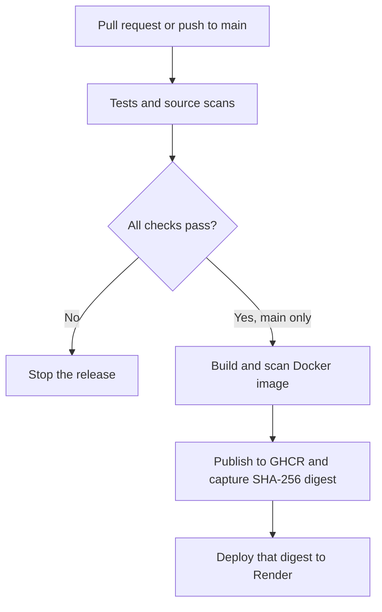

# TrustGate: Secure CI/CD for a Cloud-Native Application

TrustGate is a small Node.js API and dashboard that demonstrates how a secure release can move from a code change to a cloud deployment. GitHub Actions runs the checks. A passing release is built as a Docker image, scanned, published to GitHub Container Registry (GHCR), and sent to Render using its SHA-256 image digest.

The project avoids AWS ECS, Fargate, EKS, and cloud-network setup. Render has a free web-service option for demos, subject to its current limits.

## What the project demonstrates

- Automated API tests on pull requests and pushes to `main`.
- Dependency checks with `npm audit` and Trivy.
- Secret and vulnerability scanning of the source tree with Trivy.
- Dockerfile configuration checks with Trivy.
- Container image scanning before it is pushed.
- Least-privilege workflow permissions: registry write access is limited to the publish job.
- SHA-256 image digest capture and deployment by digest instead of a mutable tag.
- Non-root container execution, a health check, and basic browser security headers.
- Optional deployment to Render after all earlier checks pass.

## How the release works



Pull requests run the tests and source scans, check the Dockerfile, then build and scan a validation image. They do not receive permission to publish an image or deploy the app. A push to `main` repeats validation, builds and scans the release image, then uploads it only after the container scan passes. If Render credentials are not configured, image publication still completes and the deployment step reports that it was skipped.

## Run the app locally

Requirements: Node.js 24 or Docker.

### With Node.js

```bash
npm test
npm start
```

Open [http://localhost:10000](http://localhost:10000). The API also provides:

| Route | Purpose |
| --- | --- |
| `/health` | Simple health check for the host platform |
| `/api/status` | App version, runtime, and build commit |
| `/version` | Same release metadata in JSON form |

### With Docker

```bash
docker build --build-arg BUILD_SHA=local -t trustgate:local .
docker run --rm --read-only --cap-drop=ALL --security-opt=no-new-privileges -p 10000:10000 trustgate:local
```

Then open [http://localhost:10000](http://localhost:10000).

## Set up GitHub Actions and GHCR

1. Create a GitHub repository and upload the files in this project.
2. Set its default branch to `main`.
3. Open the **Actions** tab and enable GitHub Actions if GitHub asks.
4. Open a pull request into `main` to see the test and source-scan gates run.
5. Merge a passing pull request. The workflow will build the image, scan it, and publish it to `ghcr.io/<owner>/<repository>`.
6. Open the repository's **Packages** page and set the container package visibility to **Public** so Render can pull it without private-registry credentials.

The workflow pins the checkout action to a full commit SHA. The scanner containers use explicit version tags. Registry write permission is granted only to the publish job, and the `GITHUB_TOKEN` is not used until after the image passes its scan.

## Set up Render deployment

Render can deploy a prebuilt image. Create the service after the first successful workflow run:

1. In Render, create a Web Service using an existing image: `ghcr.io/<owner>/<repository>:main`.
2. Choose the free plan for a classroom demo, if it is available for your account. Set the health-check path to `/health`.
3. Create a Render API key and copy the service ID from the service details.
4. In the GitHub repository, open **Settings → Secrets and variables → Actions**. Add these repository secrets:
   - `RENDER_API_KEY`
   - `RENDER_SERVICE_ID`
5. Push a change to `main`. After the checks pass, GitHub Actions will request a Render deployment using `ghcr.io/<owner>/<repository>@sha256:…`.

Keep the Render API key in GitHub Secrets. Never add it to the source code, Docker image, `.env.example`, or a commit. The workflow does not print the key. The Render service must use the same GHCR image repository as the image URL sent by the workflow.

### Free-service note

Render's free web services are intended for testing and demos. They spin down after 15 minutes without traffic, then take about a minute to wake up. Check the current usage limits before relying on the service for a presentation.

## Why the SHA-256 digest matters

A digest is a fingerprint of the container image. The registry returns a value such as `sha256:…`; the workflow builds and scans an image, records that digest after pushing it, then asks Render to deploy `image@sha256:digest`. This avoids asking Render to resolve a moving tag such as `main` or `latest` at deployment time.

A hash detects whether the image contents differ from the image identified by that digest. A hash does **not** encrypt the image or, by itself, prove who created it. A signature or build attestation would add producer/provenance verification and is a good future extension.

## Security choices in the application

- The API uses Node.js built-in modules and has no runtime npm dependencies.
- The container runs as the unprivileged `node` user.
- The Dockerfile uses `npm ci` with lifecycle scripts disabled.
- The API only permits `GET` and `HEAD` requests and uses a fixed allowlist for static files.
- Responses include a Content Security Policy, `X-Content-Type-Options`, `X-Frame-Options`, and a restrictive Referrer Policy.
- The status endpoint reports build metadata and runtime information, but does not return environment variables or secrets.
- The health check uses `/health`; it does not expose diagnostic details.

## Project structure

```text
secure-cicd-cloud-app/
├── .github/workflows/secure-cicd.yml  # CI checks, image scan, publish, deploy
├── .github/dependabot.yml              # Action and base-image update checks
├── docs/PROJECT_REPORT.md             # Submission-style report
├── docs/VIVA_NOTES.md                 # Short explanation and viva questions
├── public/                            # Dashboard UI
├── src/server.js                      # Node.js API
├── test/server.test.js                # Automated API tests
├── Dockerfile                         # Non-root container image
└── package.json                       # Scripts and project metadata
```

## Scope and future improvements

This is a learning project, not a production security guarantee. For a production pipeline, add protected branch rules, required reviewers, action updates, image signatures or attestations, a rollback policy, and monitoring. The free Render service can sleep while idle, and the project does not store application data.
