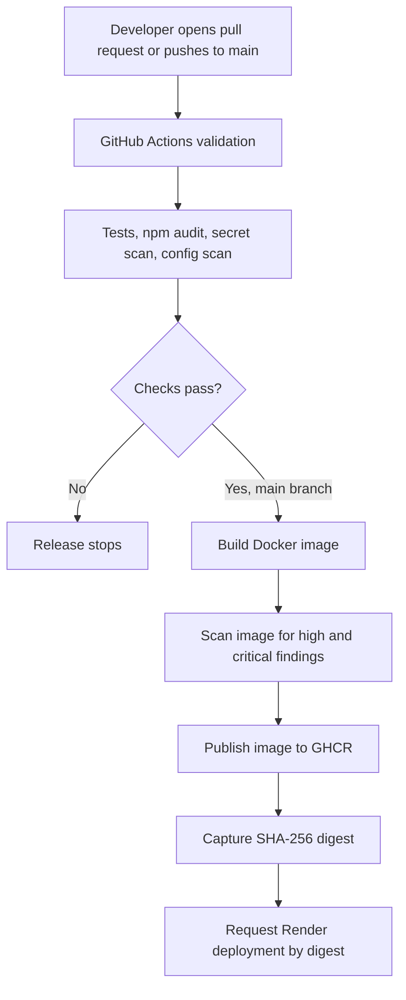

# Project Report: TrustGate Secure CI/CD Pipeline

## 1. Abstract

TrustGate demonstrates a secure delivery path for a small cloud-native application. The application is a Node.js API with a dashboard. GitHub Actions runs tests and security scans. On a successful change to the `main` branch, the workflow builds and scans a Docker image, publishes it to GitHub Container Registry, records its SHA-256 digest, and can ask Render to deploy that exact image digest.

The project focuses on reducing common release risks: broken changes, leaked credentials, vulnerable packages, unsafe container settings, and deploying a different image from the one that was checked.

## 2. Problem statement

Teams often build and deploy applications repeatedly. If these steps are manual, a developer can miss a test, publish an image with a serious vulnerability, commit a secret, or deploy a different image from the one that passed review. The project uses an automated pipeline to apply the same checks to each proposed release.

## 3. Objectives

1. Build a small Node.js application that can run inside a Docker container.
2. Run automated tests when a pull request or a change to `main` is created.
3. Scan source files for secrets and known vulnerabilities.
4. Check the Dockerfile and built image before publishing.
5. Give the pipeline only the permissions it needs for each job.
6. Record the image's SHA-256 digest and use that digest for deployment.
7. Provide clear instructions for deploying the image to a cloud host.

## 4. Technologies used

| Technology | Use in this project |
| --- | --- |
| JavaScript and Node.js | Build the API and run its tests |
| GitHub Actions | Automate checks and release steps |
| Docker | Package the application and runtime together |
| Trivy | Scan source files, the Dockerfile, and the container image |
| npm audit | Check the dependency lock file for known advisories |
| GitHub Container Registry | Store the built container image |
| Render | Optional cloud deployment target |
| SHA-256 digest | Identify the exact image that passed the scan |

The application deliberately has no runtime npm dependencies. That keeps the example small and reduces the number of third-party packages that must be trusted.

## 5. Architecture and workflow

### Pull request path

When a pull request targets `main`, GitHub Actions runs the application tests, dependency check, source secret and vulnerability scan, Dockerfile configuration scan, and a container build and image scan. The pull request does not receive permission to publish an image or deploy the app.

### Release path

When a change is pushed to `main`, the release job runs after validation succeeds. It builds a Docker image, scans that exact image, and stops if the configured high or critical vulnerability gate fails. Only after the scan passes does the job log into GHCR and publish the image. It captures the digest returned by the registry and sends that digest to Render.

If Render credentials are not configured, the pipeline still publishes the verified image and clearly reports that deployment was skipped.

## 6. Security controls

| Risk | Control | Pipeline result |
| --- | --- | --- |
| A code change breaks an API route | Automated Node.js tests | Failed tests stop later jobs |
| A secret is committed by mistake | Trivy source secret scan | A detected high or critical finding fails validation |
| A dependency has a known issue | `npm audit` and Trivy | Findings are shown before a release can proceed |
| The container includes a serious vulnerability | Trivy image scan | The image is not pushed when the gate fails |
| The workflow has excessive permissions | Read-only permissions by default; package write only in the publish job | Pull-request validation cannot publish the release image |
| A mutable tag points to a different image later | Deploy by SHA-256 image digest | Render receives the image identity returned by GHCR |
| A compromised container can write to app files | Run as the unprivileged `node` user; use read-only local run instructions | Limits the app's permissions |
| Browser content can load unsafe resources | Content Security Policy and standard security headers | Restricts scripts and framing to the same origin |

## 7. Why hashing is used

SHA-256 is a cryptographic hash function. It takes the container manifest and produces a fixed-length digest. If the image changes, its digest changes. The pipeline uses the registry's returned digest to refer to the built image as `ghcr.io/owner/repository@sha256:…`.

The digest helps with integrity and release identity: it identifies the exact image that was scanned and published. Hashing is not encryption. It does not hide the image. A digest alone also does not prove who built the image; a digital signature or attestation is needed for that extra claim.

## 8. Application endpoints

| Endpoint | Response |
| --- | --- |
| `/` | TrustGate status dashboard |
| `/health` | Small health response for the host platform |
| `/api/status` | Application version, build commit, Node.js runtime, and uptime |
| `/version` | Release metadata in JSON form |

The status response is intentionally limited. It does not print process environment variables, credentials, or stack traces.

## 9. Local setup and cloud deployment

The project report includes a complete README. In short:

1. Run the application and tests locally with Node.js, or build and run it with Docker.
2. Push the repository to GitHub and enable Actions.
3. Merge a passing change to `main`; the workflow publishes the image to GHCR.
4. Make the GHCR package public for a simple demo deployment.
5. Create a Render image-backed web service and set its health path to `/health`.
6. Add `RENDER_API_KEY` and `RENDER_SERVICE_ID` as GitHub repository secrets.
7. Push another passing change. The workflow asks Render to deploy the exact digest.

Render's free web services are suitable for a demonstration but can spin down after inactivity. The project does not claim production availability.

## 10. Limitations and future work

- The container base image uses a maintained Node.js Alpine tag. A production project should pin and update the base image by digest.
- The project records an image digest but does not yet sign it. Cosign or GitHub artifact attestations could provide producer and build provenance verification.
- Deployment uses a Render API key kept in GitHub Secrets. A production design should use a narrowly scoped deployment credential or another short-lived identity mechanism if the hosting platform supports it.
- The app is stateless and does not include a database, autoscaling, or production monitoring.
- The scan policy blocks high and critical findings; a production team should define severity exceptions and a review process rather than silently ignoring findings.
- Protected branch rules and required reviewer approval must be enabled in GitHub repository settings.

## 11. Conclusion

TrustGate shows how automated checks can sit between a code change and a cloud deployment. Tests and security scans run first. The release image is then scanned, published, identified by its SHA-256 digest, and deployed by that digest. This creates a clear, explainable release path without needing a large AWS cluster setup.

## 12. References

- GitHub Actions: publishing Docker images — https://docs.github.com/en/actions/tutorials/publish-packages/publish-docker-images
- Render API: trigger a deployment — https://api-docs.render.com/reference/create-deploy
- Render: free service limits — https://render.com/docs/free
- Trivy: official documentation — https://trivy.dev/latest/docs/
- Node.js: official documentation — https://nodejs.org/docs/latest/api/
